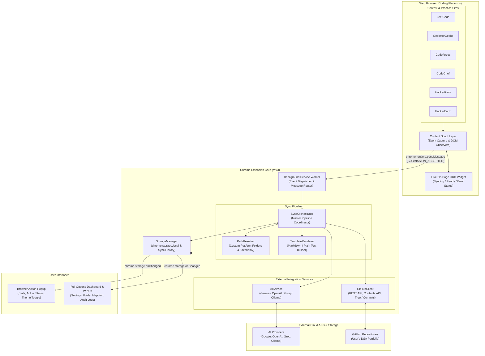
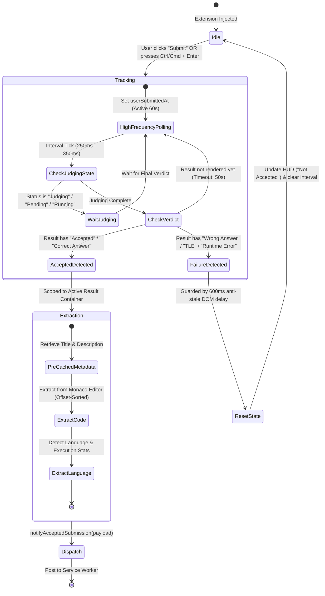
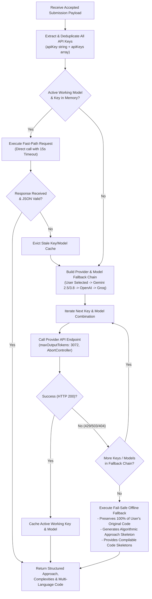

# AlgoSync AI — DSA Auto-Sync & GitHub Portfolio Chrome Extension

> **Turn your accepted DSA submissions into structured, multilingual problem documents and automatically organize them into custom GitHub folder paths per platform.**

[](https://developer.chrome.com/docs/extensions/mv3/intro/)
[](file:///test-runner.js)
[](https://github.com)
[](https://ai.google.dev/)
[](file:///options/options.html)

---

## 🌟 Overview

**AlgoSync AI** is a production-grade, Manifest V3 Chrome Extension that bridges competitive programming platforms and GitHub. Whenever you solve a problem and achieve an **Accepted** verdict on LeetCode, GeeksforGeeks, Codeforces, CodeChef, HackerRank, or HackerEarth, AlgoSync automatically:

1. **Captures the verified submission** with zero lag (Problem Title, URL, Statement, Original Code, Runtime, Memory).
2. **Preserves 100% of your original submitted code** in its original language, distinctly labeled and protected from AI-generated solutions.
3. **Analyzes your approach using an AI Engine** (Google Gemini, OpenAI, Groq Cloud, or Local/Ollama) with multi-key rotation and automated model failover.
4. **Produces multi-language implementations** in **Java, Python, C++, and Rust** complete with language-specific concepts and complexities.
5. **Renders the problem document** in either Markdown (`.md` with syntax highlighting — Recommended) or Plain Text (`.txt`).
6. **Uploads and commits the document** directly to your **custom platform-specific folder path** in your GitHub repository.
7. **Maintains live sync history and status**, offering real-time animated badges and HUD feedback.

---

## 🏗️ Architectural Flow of AlgoSync AI

AlgoSync AI is designed with a modular, decoupled architecture following Chrome Extension Manifest V3 standards. Below are the 4 core architectural diagrams illustrating the end-to-end system topology and execution pipelines.

### 1. Overall System Architecture & Data Flow



---

### 2. Platform Submission & Verdict Detection Pipeline



---

### 3. AI Multi-Engine & Automated Key Failover Architecture



---

### 4. GitHub Storage, Path Resolution & Sync Pipeline

```mermaid
flowchart LR
    Payload["Accepted Payload"] --> Normalizer["Topic Taxonomy\nNormalizer (46 Topics)"]
    
    Normalizer --> Resolver["Path Resolver\n(DSA Root Folder + Platform Subfolder)"]
    
    subgraph PathLogic ["Path Sanitization & Resolution"]
        Resolver --> TraversalCheck["Strip Directory Traversal (..)"]
        TraversalCheck --> Sanitize["Remove Illegal Filename Characters"]
        Sanitize --> FinalPath["Resolved Target: e.g. DSA/LeetCode/Two Sum.md"]
    end
    
    FinalPath --> TemplateEngine["Template Engine\n(.md or .txt)"]
    TemplateEngine --> MultiLang["Embed Sections:\n1. Details | 2. Test Cases | 3. Approach\n4. Java | 5. Python | 6. C++ | 7. Rust\n8. Motivation | 9. Centered Banner"]
    
    MultiLang --> Encoder["UTF-8 Base64 Encoder\n(Multi-byte UTF-16 safe)"]
    
    Encoder --> DuplicateCheck{"Check Local Sync\nHistory & Audit Log"}
    DuplicateCheck -- "Identical (Problem + Platform + SHA)" --> Skip["Log ALREADY_SYNCED\n(Notify HUD)"]
    DuplicateCheck -- "New / Updated" --> GHApi["GitHub Contents API (PUT)\nrepos/{owner}/{repo}/contents/{path}"]
    
    GHApi --> CommitSuccess{"HTTP 200/201?"}
    CommitSuccess -- Yes --> UpdateAudit["Update Audit Log in chrome.storage\n(Status: synced, Commit URL, Timestamp)"]
    CommitSuccess -- No --> HandleError["Log Error & Queue for Retry\n(Status: failed)"]
    
    UpdateAudit --> TriggerEvent["Emit chrome.storage.onChanged"]
    TriggerEvent --> LiveHUD["Update Page HUD: 'Synced to GitHub! 🚀'"]
    TriggerEvent --> LiveDashboard["Update Dashboard & Popup Stats in Real Time"]
```



---

## 🚀 Key Features & Capabilities

### 📂 Custom Platform Destination Paths
- Fully customizable **DSA Root Folder** (e.g., `DSA`, `CompetitiveProgramming`, `CodingPractice`, or blank for repository root).
- **Individually editable destination paths** for each platform:
  - **LeetCode**: `DSA/LeetCode` (or custom e.g., `CompetitiveProgramming/LeetCode`)
  - **GeeksforGeeks**: `DSA/GFG`
  - **Codeforces**: `DSA/Codeforces`
  - **CodeChef**: `DSA/CodeChef`
  - **HackerRank**: `DSA/HackerRank`
  - **HackerEarth**: `DSA/HackerEarth`
- **Topic Subfolder Grouping**: Optional organization by DSA topic (e.g. `DSA/LeetCode/Arrays/Two Sum.md`).
- Built-in path traversal protection (`..` stripping) and invalid character sanitization.
- One-click **"Restore Defaults"** button dynamically recalculates all paths based on your configured root folder.

### ⚡ Zero-Lag, Platform-Agnostic Verdict Detection
- **High-Frequency Active Polling (250ms–350ms)**: Eliminates detection delays the millisecond test cases finish evaluating.
- **Evaluation State Tracking**: Recognizes running states (`Judging`, `Pending`, `Running`, `Evaluating`, `Compiling`) and never triggers premature false-negative aborts while code is executing.
- **Hierarchical Submit Interception**: Captures mouse clicks across all button children (SVGs, paths, spans, nested divs) up to 6 parent levels, plus hotkey interception (`Ctrl + Enter` / `Cmd + Enter`).
- **Scoped Result Isolation**: Restricts verdict checks strictly to active result panels, ignoring historical submission tables, past attempts, and sidebar difficulty tags.
- **Monaco Line Offset Sorting (`extractCodeFromMonaco`)**: Extracts editor lines sorted by their actual vertical CSS offsets (`top: 0px`, `top: 19px`, `top: 38px`), ensuring 100% accurate indentation and line order without Monaco virtualization drops.
- **Cross-Page Persistence (`sessionStorage`)**: Seamlessly tracks submissions across full-page redirects and status table reloads on Codeforces and CodeChef.
- **Clean MathJax & HTML Sanitization**: Automatically strips MathJax stylesheets and raw CSS classes while converting TeX math blocks into clean, readable formula text.

### 🧠 Modern AI Generation with Failover
- **Latest Supported AI Models**:
  - **Google Gemini**: `gemini-2.5-flash`, `gemini-2.5-pro`, `gemini-3.8-flash`, `gemini-3.8-pro`.
  - **OpenAI**: `gpt-4o`, `gpt-4o-mini`.
  - **Groq Cloud**: `llama-3.3-70b-versatile`, `llama-3.1-8b-instant`.
  - **Custom / Local**: Any OpenAI-compatible endpoint (Ollama, vLLM, LMStudio).
- **Multi-Key Rotation & In-Memory Fast-Path**: Caches confirmed active working keys and models for sub-second subsequent generations, automatically failing over to the next key or model upon rate limits (HTTP 429).
- **Strict 15-Second Timeouts & Token Optimization**: Capped at 3072 tokens to prevent hanging requests.
- **Fail-Safe Offline Fallback**: If all AI APIs are offline or rate-limited, AlgoSync generates a complete, clean problem document preserving 100% of your submitted code and structured algorithmic approach without dropping your submission.

### 🎨 Sleek Dark & Light Mode Theme Support
- Native toggle switch supporting both **Dark Glassmorphism** and clean **Light Mode** across both the **Options Dashboard** and the **Action Popup**.
- Respects system preferences (`prefers-color-scheme`) by default while saving user selections persistently in `chrome.storage.local`.

### 📊 Real-Time Live Status & Audit Logs
- **Live Reactive Dashboard**: Listens to `chrome.storage.onChanged` to display real-time animated status badges: `Generating...`, `Uploading to GitHub...`, `Synced`, `Pending`, and `Failed`.
- **Sync History & Audit Log**:
  - Full tabular log of all processed submissions with timestamps, platforms, problem IDs, and direct links to GitHub commits.
  - **Refresh History** button for manual asynchronous reloading without full-page refreshes.
  - **Export History (CSV)** for portfolio tracking and spreadsheet analysis.
  - **Historical Duplicate Suppression**: Prevents re-uploading identical solutions already committed to GitHub.

---

## 📋 Comprehensive Problem Document Structure

Every synced problem generates a professional, interview-ready document formatted as follows:

```markdown
# Problem Title

## 1. Problem Details
- **Platform:** LeetCode
- **Question Link:** https://leetcode.com/problems/two-sum/
- **Question Name:** Two Sum
- **Question Description:**
  Given an array of integers nums and an integer target, return indices of the two numbers such that they add up to target...

## 2. Test Cases
- **Test Case 1:**
  - **Input:** nums = [2,7,11,15], target = 9
  - **Output:** [0,1]
  - **Explanation:** Because nums[0] + nums[1] == 9, we return [0, 1].

## 3. AI-Generated Approach
- **Approach:** Hash Map (One-Pass)
- **Idea:** Traverse the array while maintaining a hash map of seen values to their indices...
- **Time Complexity:** O(N)
- **Space Complexity:** O(N)

## 4. Java Solution
- **Language Concepts:** HashMap, Arrays
- **Code:**
```java
// Original Accepted Submission
class Solution {
    public int[] twoSum(int[] nums, int target) { ... }
}
```

## 5. Python Solution
- **Language Concepts:** Dict comprehension, Enumerate
- **Code:**
```python
class Solution:
    def twoSum(self, nums: List[int], target: int) -> List[int]: ...
```

## 6. C++ Solution
- **Language Concepts:** std::unordered_map
- **Code:**
```cpp
class Solution { ... };
```

## 7. Rust Solution
- **Language Concepts:** std::collections::HashMap, Ownership & Borrowing
- **Code:**
```rust
impl Solution { ... }
```

## 8. Motivation
> "The secret of getting ahead is getting started. Keep building your DSA skills day by day!"

<div align="center"> ## Thank You 🚀 </div>
```

> **Note on Language Preservation**: If you submit in a language other than the primary four (such as JavaScript, TypeScript, Go, Kotlin, or C#), AlgoSync creates a dedicated **"Original Submitted Solution"** section preserving your original code verbatim, while still providing the four standard language implementations!

---

## 📦 How to Install (Developer Mode)

1. Open Google Chrome (or any Chromium browser: Brave, Edge, Opera, Arc).
2. Navigate to `chrome://extensions/` in your address bar.
3. In the top-right corner, switch the **Developer mode** toggle to **ON**.
4. Click the **Load unpacked** button in the top-left toolbar.
5. Select the root folder of this project:
   ```
   d:\Coding Staf\Web Development\DSA_Extention
   ```
6. The **AlgoSync AI** extension icon will now appear in your browser toolbar!

---

## ⚙️ Quick Setup & Configuration

1. Click the **AlgoSync AI** toolbar icon and open the **Full Dashboard ↗**.
2. **GitHub Connection**:
   - Provide a GitHub Personal Access Token (PAT) with `repo` scope permissions.
   - Click **Verify & Connect** and choose your target repository (e.g. `username/DSA-Portfolio`).
3. **Folder Structure**:
   - Specify your **DSA Root Folder** (default: `DSA`).
   - Customize folder paths for LeetCode, GFG, Codeforces, CodeChef, HackerRank, and HackerEarth.
   - Choose document format: **Markdown (`.md`)** or **Plain Text (`.txt`)**.
4. **AI Configuration**:
   - Select your provider (**Google Gemini**, **OpenAI**, **Groq**, or **Custom/Ollama**).
   - Enter your API Key(s) (supports comma-separated multiple keys for automatic rotation).
   - Choose your preferred model (e.g., `gemini-2.5-flash`).
   - Click **Test AI Connection** and **Save Settings**.
5. **Diagnostics**:
   - In the **Diagnostics & Test** tab, click **Run End-to-End Test Sync** to verify your complete pipeline instantly without needing to solve a problem on a contest platform!

---

## 📁 Repository Directory Structure

```
username/DSA/
└── DSA/                               <-- Configurable Root Folder
    ├── LeetCode/                      <-- Configurable LeetCode Path
    │   ├── Two Sum.md
    │   └── Climbing Stairs.md
    ├── GFG/                           <-- Configurable GFG Path
    │   └── Binary Search.md
    ├── Codeforces/                    <-- Configurable Codeforces Path
    │   └── Watermelon.md
    ├── CodeChef/                      <-- Configurable CodeChef Path
    │   └── Chef and Strings.md
    ├── HackerRank/                    <-- Configurable HackerRank Path
    │   └── Array Manipulation.md
    └── HackerEarth/                   <-- Configurable HackerEarth Path
        └── Monk and Inversions.md
```

---

## 🧪 Automated Test Suite

AlgoSync AI comes with an automated Node.js test runner covering 108 end-to-end unit and integration tests across all modules.

To run the full test suite locally:

```bash
node test-runner.js
```

### Test Coverage Highlights:
- **Topic Taxonomy & Normalization**: 46 predefined computer science topics.
- **Platform Path Generation & Sanitization**: Root folder resolution, custom overrides, traversal prevention.
- **Markdown & Plain Text Template Rendering**: Complete section checks, code preservation, centered tags.
- **Code Language Detection**: Java, Python, C++, Rust, JavaScript, and niche language handling.
- **Multi-Key Extraction & Model Failover**: Deduplication, prioritization, model validation, static fallback.
- **Active Submission Intent & Polling**: Verification of verdict guards (`userSubmittedAt`) on all 6 platforms.
- **Historical Duplicate Suppression**: SHA duplicate suppression and commit cache checks.
- **Cross-Page Persistence**: Codeforces and CodeChef session storage recovery and async polling.
- **Monaco Editor DOM Line Sorting**: Verification of CSS `top` offset sorting logic.
- **MathJax Sanitization**: HTML tag stripping, MathJax CSS extraction, and formula preservation.

```
========================================
TEST RESULTS: 108 PASSED, 0 FAILED
========================================
```

---

## 🗂️ Project Codebase Architecture

```
DSA_Extention/
├── manifest.json              # Chrome Extension MV3 Manifest Configuration
├── generate-icons.js          # Standalone SVG/Canvas icon generator
├── test-runner.js             # 108-test automated verification suite
├── icons/                     # Extension icons (16px, 32px, 48px, 128px)
├── background/
│   └── service-worker.js      # Background service worker & runtime message broker
├── content-scripts/
│   ├── common.js              # HUD widget, Monaco line sorter & HTML cleaner
│   ├── leetcode.js            # LeetCode submission observer & verdict polling
│   ├── geeksforgeeks.js       # GeeksforGeeks submission observer & toast detector
│   ├── codeforces.js          # Codeforces status table watcher & session storage
│   ├── codechef.js            # CodeChef verdict poller & session storage
│   ├── hackerrank.js          # HackerRank REST API integration & code extractor
│   └── hackerearth.js         # HackerEarth submit observer & modal detector
├── popup/
│   ├── popup.html             # Action popup with live activity, stats & theme toggle
│   ├── popup.css              # Glassmorphic dark & light mode styling
│   └── popup.js               # Popup state controller & storage listener
├── options/
│   ├── options.html           # Full options dashboard, wizard & audit log UI
│   ├── options.css            # Dashboard styling, animations & theme variables
│   └── options.js             # Settings management, path tables & export controller
└── src/
    ├── constants/
    │   ├── topics.js          # 46-topic DSA taxonomy and classifier
    │   └── defaultSettings.js # Default models, platforms & path generators
    ├── storage/
    │   └── storageManager.js  # Chrome storage abstraction, history & deduplication
    ├── renderer/
    │   └── templateRenderer.js# Multi-format document builder (.md & .txt)
    ├── ai/
    │   └── aiService.js       # Multi-provider AI service with key caching & failover
    ├── github/
    │   └── githubClient.js    # GitHub REST API client & repository manager
    └── orchestrator/
        └── syncOrchestrator.js# Master sync coordinator & path resolver
```

---

## 🤝 Contributing & Feedback

Contributions, bug reports, and feature requests are welcome!
- Found a bug on a specific contest layout? Please report the problem URL and verdict state.
- Have a suggestion for additional platforms or features? Feel free to submit an issue or pull request.

---

**Built with precision and speed for competitive programmers and software engineers worldwide.**
